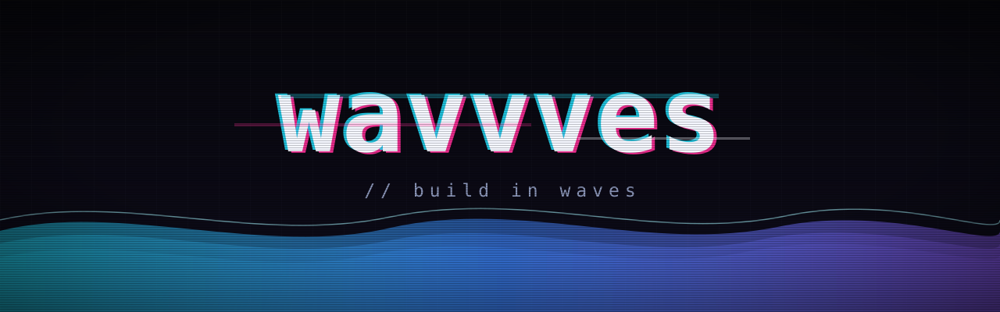
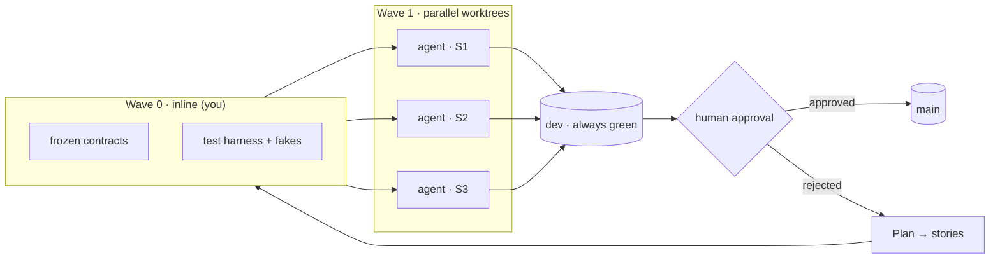

<div align="center">



### waves of agents that flood your build and leave it green


</div>

---

`wavvves` is a [Claude Code](https://claude.com/claude-code) skill that turns one session into an
**orchestrator**: it plans a large build, decomposes it into agent-sized **stories**, groups them into
dependency-ordered **waves**, runs the independent stories as **parallel sub-agents in isolated git
worktrees**, then integrates their branches onto `dev` and hands you a test plan to approve before
anything reaches `main`.

The whole method rests on one idea:

> **Parallel agents are only safe when they code against frozen contracts and never touch the same files.**

> [!WARNING]
> **wavvves spawns multiple paid sub-agents.** It always shows you a story table and a token-cost
> estimate and asks before any fan-out — but a wave is real spend (multi-agent ≈ 15× a plain chat).
> It's built for **substantial, cleanly-separable builds**; for small or tightly-coupled work it will
> tell you to just build inline.

## 🎬 Demo

<div align="center">

<!-- Record a ~20s screen capture: story table appears → agents spawn in worktrees → dev goes green wave by wave. Save it to assets/demo.gif and uncomment the line below. -->
<!--  -->

_Demo GIF coming soon — a wave of agents knocking out a build in real time._

</div>

## How it works



## What you get

| | |
|---|---|
| 🌊 **Waves, not chaos** | Dependency-ordered fan-out. Wave 0 lands foundation inline; later waves run in parallel. |
| 🔒 **Contracts first** | Frozen interfaces are the #1 defense against merge hell — agents code against stable types. |
| 📁 **File-ownership split** | Partition by non-overlapping file sets, not by "story." Bottleneck files stay orchestrator-owned. |
| 🔑 **Keyless agents** | Build & test against fakes + fixtures (`.worktreeinclude`). Real creds only at the human-test handoff. |
| 🧪 **Three honest test tiers** | Unit / integration / human-QA, declared per story. Green ≠ correct. |
| 🌿 **`main` / `dev` gate** | `dev` accumulates green work; fast-forward `main` only after a human approves. |
| 💸 **Cost discipline** | Every fan-out is gated behind a stated agent count + token estimate. |

## Install

**As a plugin (recommended):**

```
/plugin marketplace add jibril4000/wavvves
/plugin install wavvves@wavvves
```

Then invoke it in any project with `/wavvves` — or just describe a big parallel build and Claude will
propose it (and confirm before spawning anything).

**Manual install:**

```bash
git clone https://github.com/jibril4000/wavvves
cp -R wavvves/skills/wavvves ~/.claude/skills/   # personal, all projects
# or into <project>/.claude/skills/                      # project-scoped
```

Requirements: a git repository, and a Claude Code version with sub-agent worktree isolation.

## What's inside

```
skills/wavvves/
├── SKILL.md                      # the playbook: gate, Wave 0, per-wave loop, roles, tiers
├── references/
│   ├── decomposition.md          # story schema + file-ownership + wave/topo algorithm
│   ├── worktree-setup.md         # native worktree flags + environment-isolation caveats
│   └── branch-integration.md     # main/dev model, merge order, DoD enforcement
└── templates/
    ├── story-table.md            # the story table + cost declaration you fill in
    ├── agent-prompt.md           # standard keyless / no-recursion / scoped / DoD prompt
    └── human-test-plan.md        # the approval-gate handoff
```

`wavvves` uses progressive disclosure — `SKILL.md` is the concise playbook; each heavy artifact loads
only when its phase runs.

## License

MIT © Jibril — see [LICENSE](LICENSE).
